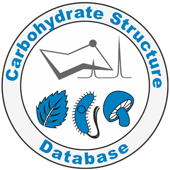

## Database Resources

Details such as status, license and future plans were recorded when each entry was added and may have changed since. GLIC has not recently re-checked them, so please confirm them on each resource's own website.

To suggest a new resource or a correction, see [how to contribute](https://github.com/glycoinfo/GLIC/blob/master/CONTRIBUTING.md) or write to the [GLIC mailing list](https://groups.google.com/g/glycoinformatics-consortium-glic).

{::options toc_levels="3" /}
* TOC
{:toc}

### GlyCosmos

Web portal that links glycan data with genes, proteins, lipids, pathways, diseases and organisms.

| **Use case** | Searching glycan-related data across many data types |
| **Data** | glycan structures, proteins, genes, lipids, pathways, diseases, organisms, etc. |
| **Search options** | glycan search options: substructure, subsumption, composition; text search across all data |
| **Access** | <https://glycosmos.org> |
| **Source code** | on request; Data Download and SPARQL endpoints available |
| **License** | CC-BY-4.0 |
| **Status** | stable, maintained |
| **Funding** | JST/NDBC of Japan |
| **Future plans** | Not specified |
| **Contact** | Kiyoko F. Aoki-Kinoshita: <kkiyoko@soka.ac.jp> |

A Web portal for glycoscience data based on Semantic Web technology.  Glycan-related data including
genes, proteins, lipids, pathways, diseases and organisms can be cross-searched, and all entries are
linked with other data where available.

### GlyGen

Integrates carbohydrate and glycoconjugate data from many international sources into one searchable portal.

| **Use case** | Searching integrated glycan and glycoprotein data, also through APIs and SPARQL |
| **Data** | glycan structures, proteins, genes, enzymes, diseases, organisms, papers etc. |
| **Search options** | glycan search options: identifier, mass, classification, subsumption, composition etc.; protein search options: identifiers, attached glycans, GO terms, PTM, disease etc.; combined search options using protein and glycan search criteria |
| **Access** | <https://www.glygen.org> |
| **Source code** | [GitHub](https://github.com/glygener) |
| **License** | [CC-BY-4.0](https://creativecommons.org/licenses/by/4.0/) |
| **Status** | stable, maintained |
| **Funding** | [NIH Glycoscience Common Fund](https://reporter.nih.gov/project-details/9942478) |
| **Future plans** | Adding more species to the database; Adding lipids to the database; Structure based search options |
| **Contact** | GlyGen Consortium <myglygen@gmail.com> |

GlyGen is a data integration and dissemination project for carbohydrate and glycoconjugate related data.
GlyGen retrieves information from multiple international data sources and integrates and harmonizes this
data. The GlyGen web portal allows exploration of this data and execution of unique searches that cannot
be performed using any of the integrated databases in isolation. GlyGen also provides machine readable APIs
and a SPARQL endpoint to access the integrated data.

### GlyTouCan

International glycan structure repository that gives each registered structure an accession number.

| **Use case** | Registering glycan structures and looking up accession numbers |
| **Data** | structure, databases references, species annotation |
| **Search options** | sub-structure search |
| **Access** | <https://glytoucan.org> |
| **Source code** | on request |
| **License** | CC-BY-0 |
| **Status** | stable, maintained |
| **Funding** | JST/NDBC of Japan |
| **Future plans** | Not specified |
| **Contact** | Kiyoko F. Aoki-Kinoshita: <kkiyoko@soka.ac.jp> |

The international glycan repository where users can register structures and obtain an accession number once validated.
Glycan database developers can become "GlyTouCan Partners" to link their data with GlyTouCan automatically.
More advanced search functionality is available from GlyCosmos at https://glycosmos.org.

### GlycomeDB

Meta-database that combines the glycan structures of several databases into one consistent representation.

| **Use case** | Finding a glycan structure across several databases |
| **Data** | structure, databases references, species annotation |
| **Search options** | structure search, sub-structure search, similarity search, maximum common substructure search, species search |
| **Access** | <http://www.glycome-db.org> |
| **Source code** | on request |
| **License** | None |
| **Status** | stable, maintained |
| **Funding** | Not specified |
| **Future plans** | Not specified |
| **Contact** | Rene Ranzinger: <rene@ccrc.uga.edu> |

Meta database that integrates the structures from several glycomics databases (CFG, KEGG, GLYCOSCIENCES.de, GlycoBase, JCGGDB, BCSDB, PDB, GlycO and Carbbank) into one consistent sequence representation and creating a unique index of all structures present in the integrated database. Species annotations from the other databases are retrieved as well and integrated using the NCBI Taxonomy. Each structure in GlycomeDB is linked back to the original database allowing finding and browsing all occurrences of a structure in multiple databases.

### UniCarbKB

Curated knowledgebase of glycan structures on glycoproteins, including site-specific attachment information.

| **Use case** | Looking up the glycosylation of glycoproteins |
| **Data** | structure, glycoproteins, site-specific information, databases references, species annotation, tissue, cell line, biological fluid, methods |
| **Search options** | structure search, sub-structure search, species search, glycoprotein search, UniProtKB accession number search, tissue search, composition search |
| **Access** | <http://unicarbkb.org> |
| **Source code** | Release 1 GitHub public, On-going developments BitBucket user managed |
| **License** | CC |
| **Status** | stable, maintained |
| **Funding** | The National eResearch Collaboration Tools and Resources (NeCTAR) Project; Swiss National Science Foundation |
| **Future plans** | Continued curation, better integration and support for GlycoRDF, improved search and query functionality |
| **Contact** | Not specified |

The UniCarb KnowledgeBase (UniCarbKB) offers public access to a growing, curated database of information on the glycan structures of glycoproteins. UniCarbKB is an international effort that aims to further our understanding of structures, pathways and networks involved in glycosylation and glyco-mediated processes by integrating structural, experimental and functional glycoscience information. This initiative builds upon the success of the glycan structure database GlycoSuiteDB, together with the informatic standards introduced by EUROCarbDB, to provide a high-quality and updated resource to support glycomics and glycoproteomics research. UniCarbKB provides comprehensive information concerning glycan structures, and published glycoprotein information including global and site-specific attachment information.

### Carbohydrate Structure Database (CSDB)

Curated database of natural carbohydrate structures, mainly from microorganisms, with NMR, taxonomic and bibliographic data.

| **Use case** | Looking up published carbohydrate structures and their NMR spectra |
| **Data** | structures, assigned NMR spectra, taxon annotations, bibliographic annatations, databases references, conformations, GT activity, supplementary data |
| **Search options** | structure search, sub-structure search, composition search, taxon search, bibliography search, NMR signal search, id search |
| **Access** | <http://csdb.glycoscience.ru> |
| **Data download** | RDF feed, flat dumps, SQL (see DOI 10.1038/s41597-022-01186-9) |
| **Source code** | no |
| **License** | None (free) |
| **Status** | stable, maintained, updated annually |
| **Coverage** | aims to be complete for glycans of bacteria, archaea, protista, fungi up to now; for plants up to 2001. Current coverage overview: <http://csdb.glycoscience.ru/database/core/covstats.html> |
| **Curated** | yes |
| **Funding** | Russian Foundation for Basic Research, Russian Science Foundation, Deutches Krebbsforschungszentrum |
| **Future plans** | see papers (<http://csdb.glycoscience.ru/help/credits.html#refs>) |
| **Contact** | Phyl Toukach: <netbox@toukach.ru> |

The Carbohydrate Structure Database (CSDB) stores structural, bibliographic, taxonomic, NMR spectroscopic, and other data on natural carbohydrates and their derivatives published in the scientific literature. The CSDB project was launched in 2005 for bacterial saccharides (as BCSDB). The database focuses mainly on glycans, glycopolymers, and glycoconjugates of microorganisms. It provides close-to-complete coverage on prokaryotes, fungi, and protista, and partial (up to 2001) coverage on plants. CSDB is regularly updated via manual expert annotation of original publications. Both newly annotated data and data imported from other databases are manually curated. The CSDB data are exportable in many formats, including GlycoRDF. CSDB providesserves as platform for glycoinformatic services. They include SNFG-compatible graphic structure editor with live update of multiple notations and simulated atomic coordinates, accurate simulation of 1H, 13C and 2D NMR spectra of saccharides, NMR-based structure prediction, glycome-based taxon clustering, prediction of molecular geometry of oligosaccharides, and other. The CSDB portal hosts additional databases for glycosyltransferases with confirmed activity, glycan conformation maps, aglycons, monomers, glycoepitopes, etc.

### SugarBindDB

Curated database of glycans bound by lectins and adhesins of human pathogens.

| **Use case** | Looking up pathogen-glycan binding |
| **Data** | structure, pathogenic lectin/adhesin, protein-carbohydrate interactions, cross-references, binding annotation, tissue, disease, symptoms, methods |
| **Search options** | species search, lectin search, ligand search, tissue search, disease search, multi-criteria search |
| **Access** | <http://sugarbind.expasy.org> |
| **Source code** | <https://bitbucket.org/sib-pig/sugarbind> |
| **License** | CC |
| **Status** | stable, maintained |
| **Funding** | SIB Swiss Institute of Bioinformatics + Swiss National Fund |
| **Future plans** | increased data integration, continued data curation, addition of binding prediction tools |
| **Contact** | Not specified |

The SugarBind Database (SugarBindDB) covers knowledge of glycan binding of human pathogen lectins and adhesins. It is a curated database; each glycan-binding event is associated with at least one published reference. The core data of SugarBindDB is a triple constituted of a pathogenic agent, a lectin/adhesin and a glycan ligand. SugarBindDB content is displayed in views. All views are interconnected.

### Glycosciences.DB

Database of the Glycosciences.de portal. Contains CarbBank structures + PDB carbohydrates + structures with NMR shifts extracted from the literature.

| **Use case** | Looking up carbohydrate structures, 3D data and NMR shifts |
| **Data** | structure, 3D structure models, pdb data, nmr shifts, species annotation, literature references |
| **Search options** | structure search, sub-structure search, motif search, n-glycan properties search, literature search, nmr peak search |
| **Access** | <http://www.glycosciences.de/database> |
| **Source code** | Not specified |
| **License** | None |
| **Status** | stable, maintained |
| **Funding** | Not specified |
| **Future plans** | Not specified |
| **Contact** | Thomas Lütteke: <thomas.luetteke@vetmed.uni-giessen.de> |

### MonosaccharideDB

Monosaccharide database. Contains monosaccharides + name parsing / encoding routines.

| **Use case** | Looking up monosaccharide properties and residue names |
| **Data** | monosaccharide properties, residue names |
| **Search options** | name search, properties search |
| **Access** | <http://www.monosaccharidedb.org> |
| **Source code** | Not specified |
| **License** | Not specified |
| **Status** | stable, maintained |
| **Funding** | Not specified |
| **Future plans** | Not specified |
| **Contact** | Thomas Lütteke: <thomas.luetteke@vetmed.uni-giessen.de> |

### GlycoMapsDB

Database of conformational maps of glycosidic linkages

| **Use case** | Looking up glycosidic linkage conformations |
| **Data** | conformational maps derived from MD simulations |
| **Search options** | disaccharide search |
| **Access** | <http://www.glycosciences.de/modeling/glycomapsdb> |
| **Source code** | Not specified |
| **License** | Not specified |
| **Status** | stable |
| **Funding** | Not specified |
| **Future plans** | Not specified |
| **Contact** | Thomas Lütteke: <thomas.luetteke@vetmed.uni-giessen.de> |

### GlycoPattern

Web resource for analysing glycan array data from the Consortium for Functional Glycomics.

| **Use case** | Glycan array data analysis |
| **Data** | Not specified |
| **Search options** | Not specified |
| **Access** | <https://glycopattern.emory.edu> |
| **Source code** | Not specified |
| **License** | Not specified |
| **Status** | Not specified |
| **Funding** | Not specified |
| **Future plans** | Not specified |
| **Contact** | <sanjay.agravat@emory.edu> |

GlycoPattern is currently in the process of identifying new funding for hosting. It is a web-based bioinformatics resource to
support the analysis of glycan array data for the Consortium for Functional Glycomics. This resource includes algorithms and tools to discover structural motifs, a heatmap visualization to compare multiple experiments, hierarchical clustering of Glycan Binding Proteins with respect to their binding motifs and a structural search feature on the experimental data.

### UniCarb-DB

UniCarb-DB is the glycomics fragmentation database that stores, integrates and processes data from manually annotated ms spectra.

| **Use case** | Looking up glycan MS/MS fragmentation spectra |
| **Data** | MS/MS spectra, structures, peak lists, references, methods, tissue and taxonomy annotations |
| **Search options** | Species, tissue, composition, recorded mass, observed mass, peak list |
| **Access** | <http://www.unicarb-db.org> |
| **Source code** | Open Source |
| **License** | CC |
| **Status** | Stable, maintained |
| **Funding** | NeCTAR, ANDS, STINT, SIB ExPASy |
| **Future plans** | Not specified |
| **Contact** | <niclas.karlsson@medkem.gu.se> |

### GlycoNAVI

Carbohydrate database of structures, chemical synthesis, NMR spectra, 3D structures and protein interactions from the literature.

| **Use case** | Looking up carbohydrate structures and their chemistry |
| **Data** | Glycan structures, chemical synthesis, carbohydrate-protein interaction, 3D-structures, and linked to other related databases. |
| **Search options** | Not specified |
| **Access** | <https://glyconavi.org> |
| **Source code** | Not specified |
| **License** | CC-BY |
| **Status** | stable, maintained |
| **Funding** | Integrated Database Project of Japan, KAKENHI |
| **Future plans** | Not specified |
| **Contact** | Issaku Yamada: <yamadaissaku@gmail.com> |

GlycoNAVI is the Carbohydrate database to support carbohydrate research. Contains glycan structures, chemical synthesis, anomeric isomer proportion, NMR spectra, activity, 3D-structures, and carbohydrate-protein interaction extracted from literatures.
