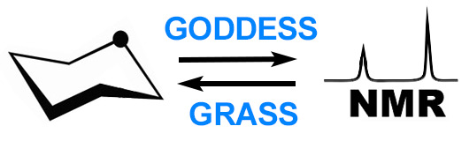

## Software Tools

Details such as status, license and future plans were recorded when each entry was added and may have changed since. GLIC has not recently re-checked them, so please confirm them on each resource's own website.

To suggest a new resource or a correction, see [how to contribute](https://github.com/glycoinfo/GLIC/blob/master/CONTRIBUTING.md) or write to the [GLIC mailing list](https://groups.google.com/g/glycoinformatics-consortium-glic).

{::options toc_levels="3" /}
* TOC
{:toc}

### SNFG Legend Generator

Creates a PowerPoint file of selected SNFG symbols for presentations and manuscripts.

| **Use case** | Preparing figures and slides that use SNFG glycan symbols |
| **Data** | None |
| **Type** | Web-based Software |
| **Access** | <https://rings.glycoinfo.org/snfg_legend_generator/new> |
| **Source code** | <https://git.rings.glycoinfo.org/SNFG/LegendGenerator> |
| **License** | CC-BY-NC |
| **Status** | Stable, version 1.0 |
| **Developers** | Sachiko Akase, Shinichi Higashimoto, Kiyoko F. Aoki-Kinoshita |
| **Funding** | Soka University |
| **Contact** | Kiyoko F. Aoki-Kinoshita: <kkiyoko@soka.ac.jp> |

SNFG Legend Generator is a simple web-based tool that generates a Powerpoint file of selected SNFG symbols which can be used for presentations and manuscripts.

### CSDB/SNFG Glycan builder

Draws glycans and glycoconjugates, and exports them as SNFG images, text notations, chemical formats and 3D models.

| **Use case** | Drawing glycan structures and converting between notations |
| **Data** | carbohydrate notations, graphical user input, molecular structure and geometry |
| **Type** | web application |
| **Access** | <http://csdb.glycoscience.ru/snfgedit/snfgedit.html> |
| **Documentation** | <http://csdb.glycoscience.ru/help/usage.html#snfgedit> |
| **License** | none (free) |
| **Status** | stable |
| **Reference** | DOI: [10.1021/acs.jcim.1c00917](https://doi.org/10.1021/acs.jcim.1c00917) |
| **Funding** | Russian Science Foundation |
| **Contact** | Phyl Toukach: <netbox@toukach.ru> |

CSDB hosts an online glycan builder to generate glycan illustrations, notation records, and atomic coordinates. It combines the benefits of classical SNFG-compatible GlycanBuilder(TM) and features of CSDB namespace and translators. You can draw any glycan or glycoconjugate, and get SNFG images, formulas, 3D models, and export to various carbohydrate notations or chemical formats. Main features are:
- all non-cyclic oligomeric and polymeric topologies;
- over 500 residues supported by CSDB, including superclasses and non-carbohydrate constituents;
- aliases for unsupported residues with SMILES specification of structure;
- name- or abbreviation-based search for residues and modifications; quick access to popular constituents;
- regular, amide, diester, chelate and carbon-carbon bonds;
- all known configuration of monosaccharides, alditols and other constituents;
- support for uncertainties at the level of residue identity, substitution pattern, residue configurations, alternative branches;
- repeating substructures including nested repeats;
- instant preview in several text notations and in SNFG;
- generation of possible isomers and instant preview of chemical structure in SMILES and as a structural formula;
- preview of the optimized 3D molecular structure with multiple rendering and export options, including SNFG-coloring of residues;
- export to CSDB Linear, WURCS, Glycam, SweetDB, GlycoCT, SMILES, MOL, and PDB formats, and to hi-res SNFG images;
- import from CSDB Linear and GlycoCT notations;
- available on the web or as a module for usage in your project.

### GRITS Toolbox

Desktop software for processing, annotating and comparing glycomics mass spectrometry data.

| **Use case** | Annotating glycomics MS data with glycan structures and fragments |
| **Data** | MS |
| **Type** | Standalone Software |
| **Access** | <http://www.grits-toolbox.org> |
| **Source code** | <https://github.com/GritsToolbox> |
| **License** | none |
| **Status** | stable, continues development |
| **Funding** | NIH |
| **Future plans** | quantification of glycomics data; CMS like methods for glycomics; integration of other data types, such as qRT-PCR |
| **Contact** | Rene Ranzinger: <rene@ccrc.uga.edu> |

GRITS Toolbox is a glycomics MS data processing software. The software allows not just to load, visualize and browser glycomics MS data but also to annotate the data with glycan structures and their fragments. Automatic annotated data can be manually evaluated, changed and exported to Excel. In addition side by side comparison of the different experiment for the study of glycosylation changes and glycosylation expression changes can be performed as well. In addition the software also captures and manages meta data such as sample description and description of the performed experiment.

### GODDESS

Simulates 1H and 13C NMR spectra of carbohydrate-containing molecules.

| **Use case** | Predicting NMR spectra of glycans, glycopolymers and glycoconjugates |
| **Data** | NMR, structures |
| **Type** | web application |
| **Access** | <http://csdb.glycoscience.ru/goddess.html> |
| **Documentation** | <http://csdb.glycoscience.ru/help/nmr.html> |
| **License** | none (free) |
| **Status** | stable, continues development |
| **Reference** | DOIs: [10.1021/ci500267u](https://doi.org/10.1021/ci500267u), [10.1021/acs.analchem.5b01413](https://doi.org/10.1021/acs.analchem.5b01413), [10.1021/acs.jcim.6b00083](https://doi.org/10.1021/acs.jcim.6b00083) |
| **Funding** | Russian Foundation for Basic Research |
| **Future plans** | NOESY simulation |
| **Contact** | Phyl Toukach: <netbox@toukach.ru> |

GODDESS stands for Glycan-Optimized Database-Driven Spectrum Simulation. It is NMR spectrum simulation service for carbohydrate-containing molecules (including polymers and glycoconjugates). The output includes signal assignment tables, 1D and various 2D spectra. For every simulated chemical shift the predictor reports the expected error, trustworthiness metrics and databases references to data used in the simulation. The software uses empirical approach with own dedicated databases, statistical approach based on CSDB content, and hybrid approach. Supported nuclei are 13C and 1H; the filters provided include solvent, temperature, and pH. The tool supports most structural features of saccharides (several hundred residues, alditols, furanoses, amino acids, fatty acids, sphingoids; glycosidic, amide, or diester linkages). Average accuracy per resonance measured on a large pool of structures was 0.69 ppm for &sup1;&sup3;C and 0.06ppm for &sup1;H.

### GRASS

Suggests and ranks carbohydrate structures that match an unassigned 13C NMR spectrum.

| **Use case** | NMR-based structure elucidation of glycans |
| **Data** | NMR, structures |
| **Type** | web application |
| **Access** | <http://csdb.glycoscience.ru/grass.html> |
| **Documentation** | <http://csdb.glycoscience.ru/help/nmr.html#grass> |
| **License** | none (free) |
| **Status** | stable, continues development |
| **Reference** | DOI: [10.1093/bioinformatics/btx696](https://doi.org/10.1093/bioinformatics/btx696) |
| **Funding** | Russian Foundation for Basic Research |
| **Future plans** | fuzzy HSQC matching |
| **Contact** | Phyl Toukach: <netbox@toukach.ru> |

GRASS stands for Generation, Ranking, and Assignment of Saccharide Structures. It is an NMR-based structure prediction service for carbohydrate-containing molecules (including polymers and glycoconjugates). The input is a digitized unassigned 13C NMR spectrum and known structural constraints (e.g. partial monomeric composition, or anomeric configurations). The output is a list of candidate structures, including all the remaining unknowns (e.g. molecule topology, sequence of residues, substitition pattern, etc.) and a metric of match. GRASS uses GODDESS to generate spectra of all chemically-possible structures within given constraints and rank them against the experimental data. It supports most known structural features of glycans, including atypical and non-carbohydrate substituents and linkage types, and can handle redundant or missing signals in the input dataset. All supported constraints are optional. The correct structure was reported among top-5 candidates in almost all cases of simple oligosaccharide structure prediction started from monomeric composition alone.

### GlycoDigest

Simulates the action of exoglycosidases on released oligosaccharides.

| **Use case** | Planning exoglycosidase digestions to determine glycan structures |
| **Data** | glycan structures |
| **Type** | Standalone software and integrated in GlycoBase and UniCarbKB |
| **Access** | <http://www.glycodigest.org> |
| **License** | CC |
| **Status** | stable, continues development |
| **Funding** | SIB; National eResearch Collaboration Tools and Resources (NeCTAR) Project |
| **Future plans** | Extend range of enzymes for simulation of activity; budding plan with CAZy team. |
| **Contact** | Matthew Campbell: <matthew.campbell@mq.edu.au> Frederique Lisacek: <frederique.lisacek@isb-sib.ch> |

GlycoDigest is a tool that simulates the action of exoglycosidases on released oligosaccharides. It has been developed to assist glycobiologists design mixtures of exoglycosidases that can be used to guide the precise determination of glycan structures.

### 3D structure validation tools (CARP, pdb-care)

Tools for validation of carbohydrate 3D structure data.

| **Use case** | Checking carbohydrate 3D structures in PDB files |
| **Data** | PDB-formatted 3D structures (carbohydrates, glycoproteins, protein-carbohydrate complexes) |
| **Type** | Web application, Integrated in Glycosciences.de |
| **Access** | <http://www.glycosciences.de/tools> |
| **License** | Not specified |
| **Status** | stable, continues development |
| **Funding** | Not specified |
| **Future plans** | Include MonosaccharideDB routines for improved handling of modified residues. |
| **Contact** | Thomas Lütteke: <thomas.luetteke@vetmed.uni-giessen.de> |

### Sweet-II

Building of 3D structure models of carbohydrates.

| **Use case** | 3D modelling of carbohydrates |
| **Data** | carbohydrate “sequence” (2D-structure) |
| **Type** | Web application, Integrated in Glycosciences.de |
| **Access** | <http://www.glycosciences.de/modeling/sweet2> |
| **License** | Not specified |
| **Status** | stable |
| **Funding** | Not specified |
| **Future plans** | Not specified |
| **Contact** | Thomas Lütteke: <thomas.luetteke@vetmed.uni-giessen.de> |

### GlyProt

In-silico glycosylation of protein 3D structures.

| **Use case** | 3D modelling of glycoproteins |
| **Data** | Protein 3D structure (PDB format), carbohydrate “sequence” (2D-structure) |
| **Type** | Web application, Integrated in Glycosciences.de |
| **Access** | <http://www.glycosciences.de/modeling/glyprot> |
| **License** | Not specified |
| **Status** | stable |
| **Funding** | Not specified |
| **Future plans** | Not specified |
| **Contact** | Thomas Lütteke: <thomas.luetteke@vetmed.uni-giessen.de> |

### ISOGlyP (Isoform Specific O-Glycosylation Prediction)

Predicts isoform-specific sites of mucin-type O-glycosylation in a protein sequence.

| **Use case** | O-glycosylation site prediction |
| **Data** | FASTA format protein sequence (manual or file input) |
| **Type** | Web application |
| **Access** | <http://isoglyp.utep.edu> |
| **License** | none |
| **Status** | available, under development |
| **Funding** | NIH (data acquisition and web site 1/2015-11/2018) |
| **Future plans** | include remote glycosylation with improved output graphics, add core 1 & 3 and sialylation predictions |
| **Contact** | T. Gerken: <txg2@cwru.edu> Tel: 216-368-4556 M. Y. Leung: <mleung@utep.edu> Tel: 915-747-6836 |

ISOGlyP  analizes and roughly predicts isoform specific sites of mucin O-glycosylation for an entered protein sequence .  Future goals are to add the long range enhancing effects of remote O-glycosylation and the action of multiple transferases.  This work is being performed by a collaboration of Thomas Gerken at Case Western Reserve Univ. (School of Medicine) and  Ming-Ying Leung at the Univ. Texas at El Paso (Professor of Mathematical Sci. and Director Bioinformatics Program).  The Gerken  lab is generating the actual data utilizing a series of unique random (glyco)peptides (refs below) and the Leung lab has developed the web site.  We presently have the peptide sequence motif/propensity data for 10 of the 20 isoforms on the site and have generated the remote glycopeptide data on ~11 isoforms (not yet on the site).  We also have plans for developing similar approaches to predict the Core 1, Core 3 and sialylation substitution of the peptide GalNAc by similar methods.

References:

* Perrine et al (2009) <http://glycob.oxfordjournals.org/content/19/3/321>
* Gerken et al. (2011) <http://www.jbc.org/content/286/16/14493>
* Gerken et al  (2013) <http://www.jbc.org/content/288/27/19900>
* Kong et al (2015)    <http://glycob.oxfordjournals.org/content/25/1/55.abstract>

### GlycReSoft  (1)

Assigns site-specific glycosylation from bottom-up LC-MS data.

| **Use case** | Glycomics and glycoproteomics LC-MS data analysis |
| **Data** | Spectrometry data |
| **Type** | Stand-alone and Web application |
| **Access** | <https://github.com/GlycReSoft2> |
| **License** | Tentatively Apache2, but always free for academic use |
| **Status** | Available, Under Development |
| **Funding** | Not specified |
| **Future plans** | Not specified |
| **Contact** | Joseph Zaia: <jzaia@bu.edu> |

GlyReSoft is a modular software tool for assigning site specific glycosylation from bottom-up mass spectrometry data sets.  The tool accepts LC-MS data from any vendor converted into public data formats and contains modules for following tasks:

  *  Assigning and scoring glycomics LC-MS profiling data.

  *  Calculating glycopeptide search space size informed by glycomics and proteomics information.

  *  Assigning and scoring glycan and glycopeptide MS and tandem mass spectra.

  *  Calculating false discovery rates from glycopeptide search spaces constructed using glycomics and proteomics data.

References:
Maxwell, E., Tan, Y., Tan, Y., Hu, H., Benson, G., Aizikov, K., Conley, S., Staples, G. O., Slysz, G. W., Smith, R. D., and Zaia, J. (2012) GlycReSoft:A Software Package for Automated Recognition of Glycans from LC/MS Data. PLoS ONE 7, e45474

### HS-SEQ (2)

Sequences glycosaminoglycan saccharides from ExD tandem mass spectra.

| **Use case** | Glycosaminoglycan sequencing by mass spectrometry |
| **Data** | Not specified |
| **Type** | Stand-alone |
| **Access** | <https://github.com/hh1985/glycan-pipeline> |
| **License** | Not specified |
| **Status** | Not specified |
| **Funding** | Not specified |
| **Future plans** | Not specified |
| **Contact** | Joseph Zaia: <jzaia@bu.edu> |

HS-SEQ is a comprehensive algorithm for sequencing of glycosaminoglycan saccharides from activated electron dissociation (ExD) tandem mass spectra. ExD methods encompass ion electron detachment dissociation (EDD) and negative electron transfer dissociation (nETD).

References:
Hu, H., Huang, Y., Mao, Y., Yu, X., Xu, Y., Liu, J., Zong, C., Boons, G. J., Lin, C., Xia, Y., and Zaia, J. (2014) A Computational Framework for Heparan Sulfate Sequencing Using High-resolution Tandem Mass Spectra. Molecular & cellular proteomics : MCP 13, 2490-2502

### GlyPy

Python library for reading, writing, building and analysing glycan structures.

| **Use case** | Writing your own glycan analysis code in Python |
| **Data** | Not specified |
| **Type** | Software Library |
| **Access** | <https://github.com/mobiusklein/glypy> |
| **License** | Tentatively Apache2, but always free for academic use |
| **Status** | Available, Under Active Development (Feature Requests and Pull Requests Welcome) |
| **Funding** | Not specified |
| **Future plans** | Continued development of glycan structure model and algorithms on that model. |
| **Contact** | Joseph Zaia: <jzaia@bu.edu> |

GlyPy is a modular and extensible library of glycan manipulation tools built in python with minimal dependencies.   This library is available for researchers as a resource to solve glyco-bioinformatics problems.  All that is required is a minimal knowledge of the general purpose, high level, python programming language. Designed for both batch processing and interactive use.
The library includes the following functions:

  * Read and write condensed GlycoCT, GlycoMinds Linear Code, IUPAC Linear Code, and read GlycoCT XML glycan structures

  * Calculate structure masses from monoisotopic or average composition, under theoretical neutral charge or under any charge state.

  * Build and modify glycan structures dynamically, with reverse-ability maintained wherever possible, adding or removing modifications, substituents, monosaccharides or other glycans to the graph structure.

  * Interact with glycan structures using natural pythonic expressions, providing a rich iterative interface for transforming graphs.

  * Generate fragments of glycan structures by cleaving one or more glycosidic bonds. Can generate A, B, C, X, Y and Z ions, as well as internal fragments

  * Derivatize glycan structures with arbitrary substituents.

  * CFG-style plots with colored shapes or IUPAC text for nodes.

  * GlycomeDB API and partial support for the recently exposed glySpace REST API

  * Self-documenting with Sphinx

  * Near 100% test coverage on the core library

  * Build portable databases of structures, indexed for fast search and retrieval.

  * Define new types of substituents and modifications as needed.

### GLAD

Web tool to visualise, analyse and compare glycan microarray data.

| **Use case** | Exploratory analysis of glycan array data |
| **Data** | None |
| **Type** | Web-based Software |
| **Access** | <https://www.glycotoolkit.com/GLAD> |
| **Source code** | N/A |
| **License** | CC-BY |
| **Status** | Stable, version 2.0 |
| **Developers** | Akul Y. Mehta |
| **Funding** | NIH |
| **Contact** | Akul Y. Mehta: <aymehta@bidmc.harvard.edu>   Richard D. Cummings <rcummin1@bidmc.harvard.edu> |

GLAD (Glycan Array Dashboard) is a web-based tool to visualize, analyze and compare glycan microarray data. The application allows users to load data from multiple microarray experiments and visualize the data using different visualization forms such as heatmaps, correlation maps, force graphs and more. GLAD allows users to view glycan structure alongside the microarray data at any time, provided the glycan names are entered in the CFG linear nomenclature format (modified condensed IUPAC nomenclature) with the input data. The visualizations produced can be saved as vector graphic (SVG) files and can be used for publications.

### GlycoGlyph

Web tool to draw glycans in SNFG format and name them in CFG linear nomenclature and GlycoCT.

| **Use case** | Drawing and naming glycan structures |
| **Data** | None |
| **Type** | Web-based Software |
| **Access** | <https://www.glycotoolkit.com/GlycoGlyph> |
| **Source code** | <https://github.com/akulmehta/GlycoGlyphPublic/> |
| **License** | MIT |
| **Status** | Stable, version 1.0.1 |
| **Developers** | Akul Y. Mehta |
| **Funding** | NIH |
| **Contact** | Akul Y. Mehta: <aymehta@bidmc.harvard.edu>   Richard D. Cummings <rcummin1@bidmc.harvard.edu> |

GlycoGlyph is an open source web-based glycan drawing and naming tool which is completely driven by JavaScript. Glycans can be drawn using a graphical user interface or using names written in CFG linear nomenclature (modified IUPAC condensed linear nomenclature). The structures are drawn as per SNFG specifications with capabilities for size adjustments and can be saved as vector graphic (SVG) files. The tool also produces the CFG name and GlycoCT. The GlycoCT can in-turn be used to retrieve the GlyTouCan accession number directly from the application.
